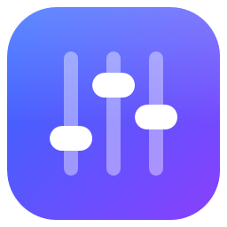
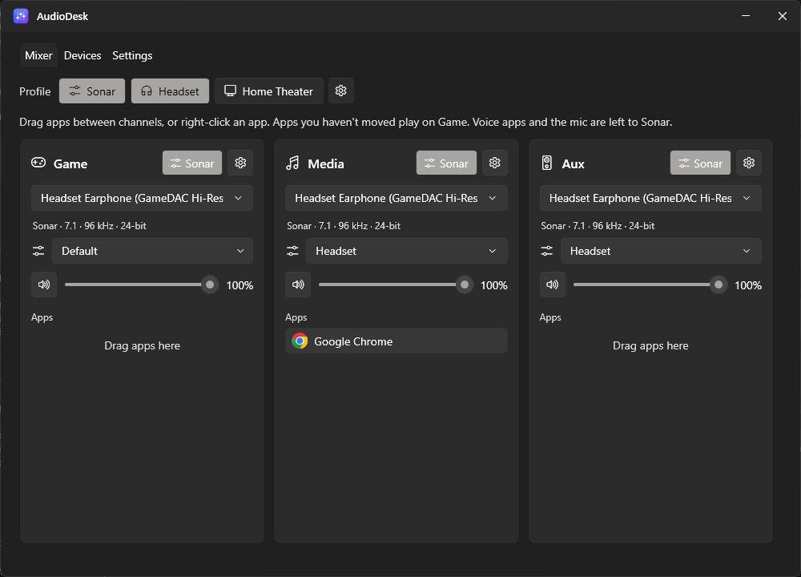
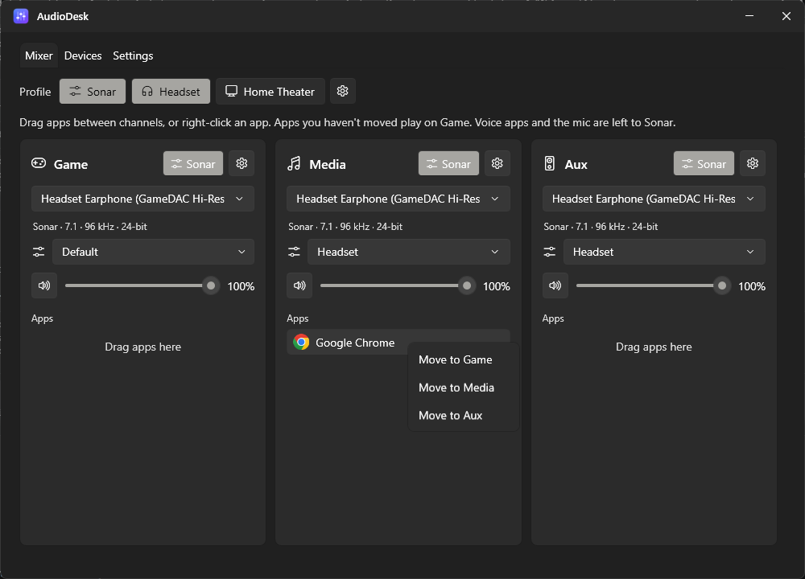
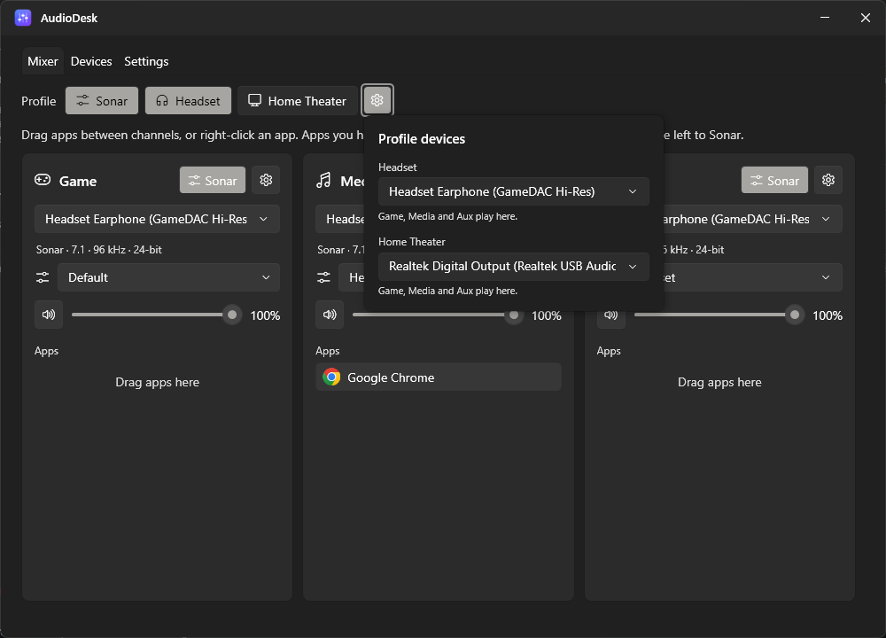
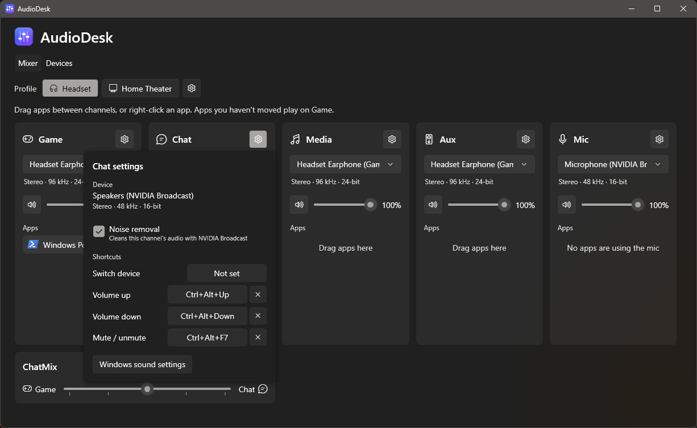
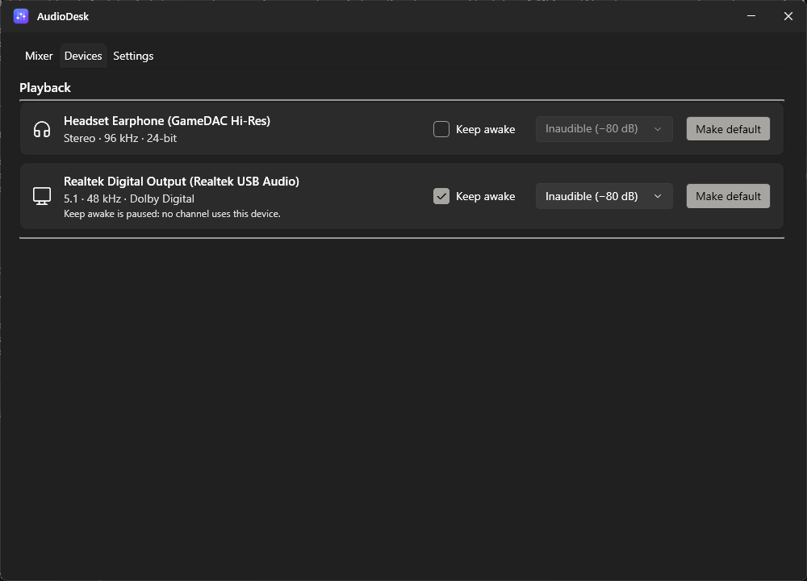

<p align="center">
  
</p>

<h1 align="center">AudioDesk</h1>

<p align="center">
  A helper for SteelSeries Sonar on Windows.<br />
  Choose per channel what goes through Sonar and what bypasses it to play lossless on your real device, at that
  device's full sample rate, bit depth and channel count, with more control over Sonar from one window.
</p>

---



## Contents

- [Why AudioDesk](#why-audiodesk)
- [Features](#features)
- [Requirements](#requirements)
- [Installing and running](#installing-and-running)
- [Using AudioDesk](#using-audiodesk)
  - [Channels](#channels)
  - [Moving apps between channels](#moving-apps-between-channels)
  - [Profiles: Sonar, Headset and Home Theater](#profiles-sonar-headset-and-home-theater)
  - [Channel settings](#channel-settings)
  - [Through Sonar (SteelSeries Sonar)](#through-sonar-steelseries-sonar)
  - [Keep device awake](#keep-device-awake)
  - [Devices tab](#devices-tab)
  - [Tray icon](#tray-icon)
  - [Settings tab](#settings-tab)
- [Voice chat and the microphone](#voice-chat-and-the-microphone)
- [How it works](#how-it-works)
- [Settings file](#settings-file)
- [Command-line options](#command-line-options)
- [Local API](#local-api)
- [Troubleshooting](#troubleshooting)
- [Limitations](#limitations)
- [Building from source](#building-from-source)
- [Project structure](#project-structure)

---

## Why AudioDesk

SteelSeries Sonar gives you separate channels by installing **virtual audio devices**. Apps play into Sonar's
virtual device, Sonar processes the sound, and then copies it to your real headset or speakers. That's what makes
its EQ and effects possible, but it has a cost for everything that goes through it, even audio you don't want to
process:

| | Through Sonar | Bypassing Sonar (AudioDesk) |
|---|---|---|
| Path | App → Sonar's virtual device → Sonar → real device | App → real device |
| Sample rate / bit depth | Set by Sonar, not your DAC | Whatever the real device runs at (e.g. 96 kHz / 24-bit) |
| Surround | Sonar's format | 5.1 / 7.1 passes straight through, e.g. Dolby Digital to a receiver |
| Extra delay | Yes (copying between devices) | None |
| EQ / effects / virtual surround | Yes | No (play it through Sonar for those) |

AudioDesk lets you have both. Each channel either goes through Sonar for its EQ and effects or bypasses it and
plays lossless on your real device, and you can switch per channel or all at once. Sonar keeps running for what it
does best (voice chat, the microphone, EQ), while AudioDesk handles the app routing and gives you more control over
Sonar: its device, presets and volume per channel, presets that follow the device, and profiles, from one window
and the tray.

The routing uses Windows' own per-app routing, the same mechanism behind
*Settings → System → Sound → Volume mixer → App output device*, so AudioDesk installs no drivers or virtual devices
of its own.

## Features

- **Through Sonar or bypass it:** one switch per channel to send it through SteelSeries Sonar for its EQ and
  effects, or straight to your real device at full quality.
- **More control over Sonar:** pick the device Sonar plays each channel on, pick Sonar presets (with a searchable
  list for Game), link a preset to each device, and use Sonar's own volume and mute, all kept in step with
  SteelSeries GG.
- **Three channels: Game, Media and Aux**, each with its own device, volume and mute.
- **Drag-and-drop routing:** drag an app from one channel to another, or right-click it and choose *Move to…*.
- **Full quality:** each channel shows the real format of its device, e.g. *5.1 · 48 kHz · Dolby Digital* or
  *Stereo · 96 kHz · 24-bit*.
- **Profiles:** in one click, send Game, Media and Aux all through **Sonar**, or to your **Headset** or
  **Home Theater**.
- **Keep device awake:** plays inaudible noise to a receiver or soundbar so it never sleeps and doesn't cut off
  the start of sounds after a pause.
- **Tray icon:** pick devices and profiles from the tray; AudioDesk keeps working with the window closed.
- **Self-healing routing:** new apps are sorted into their channel automatically, and if anything moves an
  app (Windows, another mixer, the app itself), AudioDesk puts it back.
- **Never freezes:** device switches run in the background and show a loader.
- Windows 11 look (Fluent theme) that follows your light/dark setting.

## Requirements

- **Windows 11**, or Windows 10 version 21H2 or later (per-app routing needs 21H2+).
- Nothing else when you use the installer (it includes .NET). To build from source: the **.NET 10 SDK**.
- **SteelSeries Sonar** (in SteelSeries GG, **Classic** mode) for the Sonar features. Without it, AudioDesk still
  routes every channel straight to your devices.

Installing needs administrator rights (AudioDesk installs for all users, into Program Files); AudioDesk itself runs
without them and doesn't install drivers.

## Installing and running

**With the installer (recommended):** download `AudioDesk-<version>-x64.msi` from the
[latest release](https://github.com/Shyam-Sangeeth/AudioDesk/releases/latest) and run it (or build it yourself, see
[Building the installer](#building-the-installer)).

- Installs for all users into `C:\Program Files\AudioDesk`, so Windows asks for administrator rights. The
  **Destination Folder** page lets you choose another folder or drive with **Change...**.
- Adds a Start menu shortcut and an entry in **Settings → Apps** (for uninstalling).
- The welcome screen has **"Start AudioDesk when Windows starts"**: ticked for new installs; when upgrading it
  keeps your current choice.
- Starts AudioDesk when it finishes (as you, not with the installer's administrator rights).
- **Upgrading:** use **Settings → Updates** in AudioDesk, or run a newer installer. It installs into the folder you
  chose last time, closes AudioDesk, replaces it and starts it again; your settings stay. Windows asks for
  administrator rights each time.
- **From 1.0.0 or 1.0.1:** those versions installed for your account only, into `%LocalAppData%\Programs\AudioDesk`.
  Uninstall that copy first (Settings → Apps → AudioDesk), then run the new installer; your settings are kept.
- **Uninstalling** (Settings → Apps → AudioDesk) closes AudioDesk and removes its Start with Windows entry.
  Your settings file (`%AppData%\AudioDesk`) is kept in case you reinstall.

**Without installing:** build it (see [Building from source](#building-from-source)) and run
`publish\AudioDesk.exe`. To start it automatically: **Settings** tab → **Start with Windows**; it then starts
minimised to the tray at sign-in.

Only one copy runs at a time. Launching it again brings the existing window to the front.

SteelSeries Sonar can keep running alongside AudioDesk. AudioDesk does all the app routing; Sonar only
processes the channels you send [through Sonar](#through-sonar-steelseries-sonar). Assign apps to channels in
AudioDesk, not in Sonar: AudioDesk moves apps back to their channel's device.

## Using AudioDesk

### Channels


Each card is a channel:

| Channel | What it's for | Device |
|---|---|---|
| **Game** | Games, and every app you haven't moved | Your Windows **default output**. Changing it here changes the Windows default. |
| **Media** | Music, videos, browsers | Any output. |
| **Aux** | Anything you want to keep separate | Any output. |

In each card:

- **Sonar** button (when SteelSeries Sonar is installed): sends the channel
  [through Sonar](#through-sonar-steelseries-sonar) or straight to its device.
- **Device picker:** real devices only (Sonar's virtual devices are chosen with the **Sonar** button). The line
  under it shows what the device really runs at.
- **Live level meter:** like the Windows 11 volume slider, a green glow inside the slider track moves with the
  channel's audio. It fills the part of the track left of the knob and stays empty while muted. It only runs
  while the window is visible.
- **Volume slider and mute button:** on a channel that goes straight to a device, they set each app's own volume
  in the Windows mixer, which is applied in 32-bit float inside the audio engine, so it doesn't reduce quality.
  On a channel that goes through Sonar, they are Sonar's own volume and mute for that channel (the slider you see
  in SteelSeries GG): changing one changes the other. The apps in that channel stay at full volume in the Windows
  mixer, so only Sonar's slider sets the level; when the channel comes off Sonar, its own volume comes back.
- **Apps:** the apps in this channel. A green dot means the app is playing right now.
- **Speaker tag:** on a surround device, each app shows which speakers it's feeding: **Stereo** (front left and
  right only), **5.1** or **7.1** (sound reached the centre, subwoofer or surround speakers), or **Mono** (centre
  only). It covers the last few seconds, so quiet moments don't flip it, and disappears when the app goes silent.
  Use it to check whether a game really outputs surround. It isn't shown on stereo devices, or on devices with
  audio enhancements that remix every app (such as a Dolby or Realtek upmixer), because there stereo already
  reaches every speaker before AudioDesk can see it.

**When a device disappears** (unplugged, or Sonar closed), Media and Aux keep working: the channel temporarily
uses the device it used before Sonar, otherwise your headset, otherwise Game's device. The card says *Saved device
is unavailable, using this one for now*, and the channel goes back to the saved device by itself when it returns.

### Moving apps between channels

Drag an app onto another channel, or right-click it:



AudioDesk remembers the choice by program name (e.g. `chrome`, `Spotify`), so the app goes back to the same
channel every time it starts. Apps appear in AudioDesk once they've played sound (or once you've moved them to a
channel). Background tools that only hold a silent audio session, like RGB software, stay hidden but are still
routed.

If an app keeps playing on the old device after you move it, restart that app. Some games only pick their
output device at launch.

### Profiles: Sonar, Headset and Home Theater

The **Profile** buttons above the channels move Game, Media and Aux together:

| Profile | Sonar on (every channel through Sonar) | Otherwise |
|---|---|---|
| **Sonar** (when Sonar is installed) | Takes every channel off Sonar again | Sends every channel through Sonar |
| **Headset** | Sonar plays every channel on the headset | Every channel comes off Sonar and plays straight on the headset |
| **Home Theater** | Sonar plays every channel on the home theater | Every channel comes off Sonar and plays straight on the home theater |

**Sonar** is highlighted while every channel goes through Sonar. **Headset** or **Home Theater** is highlighted
when every channel ends up on that device, directly or through Sonar, so with Sonar on two buttons can be
highlighted: Sonar, and where Sonar plays. The profile's device also becomes the one each channel goes back to
after Sonar. If your channels match no profile, no button is highlighted.

While a switch is in progress, each affected channel shows a thin loader bar right under its device picker.

The **⚙** next to the profiles chooses which device each profile uses:



If you change speakers (e.g. from an optical receiver to analogue 5.1 speakers), just pick the new device as
**Home Theater** here.

### Channel settings

Each channel has a **⚙** button that opens its settings:



- **Device:** the full device name (the drop-down cuts long names off) and its real format.
- **Sonar preset for each device** (Media and Aux, while the channel goes through Sonar): the preset Sonar
  switches to on each device; see [Through Sonar](#through-sonar-steelseries-sonar).
- **Windows sound settings:** opens the classic Sound control panel.

### Through Sonar (SteelSeries Sonar)

Sonar processes audio in its own virtual devices, at their format (set in Sonar, not your DAC's), before passing
it to your real device. With [SteelSeries Sonar](https://steelseries.com/gg/sonar) installed, every channel card
gets a **Sonar** button next to its ⚙, so you choose which channels get Sonar's EQ and effects and which play
directly on your DAC or headset:

| Channel | Through Sonar uses |
|---|---|
| Game | *SteelSeries Sonar - Gaming* (as the Windows default output) |
| Media | *SteelSeries Sonar - Media* |
| Aux | *SteelSeries Sonar - Aux* |

- **On (highlighted):** the channel uses Sonar's device. Sonar applies its EQ and effects and plays the result on
  the output you picked in Sonar.
- **Off:** the channel goes back to the device it used before, at that device's full quality.

While a channel goes through Sonar, its device picker shows the real device **Sonar** plays that channel on, and
picking another device changes it in Sonar too (the same as choosing the output in SteelSeries GG). The tray menu
does the same. Changes made in SteelSeries GG show up in AudioDesk within a couple of seconds.

A **preset** picker also appears under the format line, listing the presets you've marked as **favourites** in
Sonar (in Sonar's order), plus the selected one if it isn't a favourite. Picking one selects it in Sonar. New
favourites show up within about 30 seconds.

**Game** has hundreds of Sonar presets, so its preset opens a searchable list instead: type to filter by name,
and turn **Favourites only** (on by default) off to see every preset. Favourites are marked with a star and the
selected preset is in bold. **Enter** picks the first match, **Esc** closes the list.

**Media** and **Aux** can link a preset to each device: in the channel's **⚙** settings, under *Sonar preset for
each device*, the list starts with a **Default** row (*Don't change* or a favourite preset), and each device row
offers *Use default* or a favourite preset. When Sonar's device for that channel changes (from the card's picker,
a profile, the tray, or SteelSeries GG), the device's own preset is selected, or the Default preset if the device
is set to *Use default* (if Default is *Don't change*, the preset is left alone). A preset you pick by hand
stays until the device changes again. Links are saved in `mixer.json`.

SteelSeries GG's own Sonar page doesn't refresh when AudioDesk changes a preset or device: Sonar applies the change
right away, but GG shows it only after you switch pages in GG or reopen it.

The format line shows the format Sonar processes the channel in, e.g. *Sonar · 7.1 · 96 kHz · 24-bit*. This uses
the local connection SteelSeries GG's own Sonar page uses, so it needs Sonar in **Classic** mode; it isn't an
official API and could stop working after a GG update.

To switch all three at once, use the [profiles](#profiles-sonar-headset-and-home-theater): **Sonar** sends every
channel through Sonar (click it again to turn Sonar off for all of them), and **Headset** or **Home Theater**
then changes where Sonar plays.

On a channel that goes through Sonar, the volume slider and mute are Sonar's own for that channel, so they stay
in step with SteelSeries GG. When Sonar isn't running, Media and Aux play on the device they'd go back to, and
return to Sonar when it starts again.

Sonar makes its own devices the Windows defaults when it starts, so **Game** may show **Sonar** on by itself.
Click it off to send games straight to your real device.

### Keep device awake

Many receivers and soundbars, especially on optical (S/PDIF) or HDMI, go to sleep when the audio signal stops.
When sound starts again they need a moment to lock back on, so the first second gets cut off, e.g. after you
pause a video for a while and press play.

**Keep device awake** fixes this by playing very quiet white noise to the device whenever nothing else is
playing, so the signal never stops. While another app plays on the device its audio keeps the receiver awake, so
the noise pauses; it resumes within about half a second of the device going quiet. Turn it on with the
**Keep awake** checkbox on the [Devices tab](#devices-tab), and pick the level next to it.

A small green wave (∿) after the device's format shows when the noise is actually playing, on the channels that
use the device and on the Devices tab.

The noise only plays while a channel (Game, Media or Aux) is using the device. With the Headset profile
active, a kept-awake home theater gets no noise; switch to Home Theater and it starts automatically. While it's
waiting, the device's card says *Keep awake is paused: no channel uses this device*.

| Level | Use |
|---|---|
| Inaudible (−80 dB) | Default; enough for most receivers |
| Very quiet (−70 dB) | If the device still falls asleep |
| Quiet (−60 dB) | Last resort |

- The setting is saved per device and starts with AudioDesk. If the device restarts (default switch, unplug,
  format change), the noise starts again automatically.
- The noise is mixed by Windows like any other sound, so it also goes through effects such as Dolby Digital Live
  encoding, which keeps the encoded stream running too.
- While the noise plays, the device is always in use: the receiver won't go to standby on its own, and players
  that need the device **exclusively** (bitstream passthrough in VLC, MPC, Kodi) can't open it. Turn it off for
  those.

### Devices tab



All active real playback devices with their real format (virtual devices such as Sonar's aren't listed).
**Default** marks the Windows default device. Use **Make default** to change it, and **Keep awake** to
[keep a playback device awake](#keep-device-awake).

### Tray icon

Closing the window keeps AudioDesk running in the tray, so channels keep working.

- **Left-click:** open the window.
- **Right-click:**
  - **Sonar / Headset / Home Theater:** switch profile (the active one is ticked).
  - **Game / Media / Aux:** pick that channel's device.
  - **Open AudioDesk**, **Exit**.

Windows may put the icon in the hidden-icons area (**^** next to the clock). Drag it onto the taskbar to keep it
visible.

### Settings tab

- **Start with Windows:** starts AudioDesk in the tray when you sign in, so channels and keep awake
  work right away. (It adds AudioDesk to your Windows startup apps; you can also turn it off in
  *Settings → Apps → Startup*.)
- **Knob support:** lets Knob Hub's AudioDesk app control AudioDesk from the knob, through the
  [local API](#local-api). On by default; turning it off closes the API and disconnects the knob.
- **About:** the installed version.
- **Updates:** **Check for updates** looks for a newer [release on GitHub](https://github.com/Shyam-Sangeeth/AudioDesk/releases).
  If there is one, **Download and install** downloads its installer, verifies it (size and the SHA-256 checksum
  GitHub publishes) and runs it; Windows asks for administrator rights, then AudioDesk closes, is upgraded with your
  settings kept, and starts again.
  **What's new** opens the release notes. With **Check for updates automatically** on (the default), AudioDesk
  checks once, shortly after it starts, and shows a notification you can click to update.

## Voice chat and the microphone

AudioDesk leaves voice apps and the microphone to SteelSeries Sonar; it does not list, route or change their
volume.

In Discord, set the output device to **SteelSeries Sonar - Chat** and the input device to **SteelSeries Sonar -
Microphone** (**User Settings → Voice & Video**).

## How it works

- **Per-app routing:** apps are sent to their channel's device with Windows' per-app default endpoint
  (`IAudioPolicyConfigFactory`, the API behind the Volume mixer's per-app device setting). Windows remembers it
  per program. Apps in Game have no override, so they follow the Windows default.
- **Default device:** Game *is* the Windows default playback device, set with `IPolicyConfig` (the same call the
  Sound control panel uses).
- **Enforcement:** every 1.5 s AudioDesk scans audio sessions and re-applies routing where needed. This is how
  new apps get sorted, and how apps moved by something else are put back.
- **Volume:** channel volume and mute are applied to each app's session volume, or to Sonar's own channel volume
  (through Sonar's local web server) while the channel goes through Sonar.
- **No freezing:** switching a default device can take a couple of seconds while the device restarts (an
  S/PDIF output with Dolby encoding also restarts its encoder). Switches, session scans and device reads run on
  worker threads. The window reads devices from a cache that refreshes when Windows reports a change.
- **Rendering:** the window uses WPF's software renderer, because GPU rendering drew a blank window on the
  development PC.

## Settings file

Settings are saved to:

```
%APPDATA%\AudioDesk\mixer.json
```

It contains the channel devices (and the device each goes back to after Sonar), volumes and mute states, the Sonar
preset linked to each device, which channel each app belongs to (by process name), profile devices, the
kept-awake devices with their noise levels, whether to check for updates and whether knob support is on. It's plain JSON. To start over, quit
AudioDesk and delete the file.

Windows also remembers per-app device choices itself. To clear those: *Settings → System → Sound → Volume
mixer → Reset*.

## Command-line options

| Option | Effect |
|---|---|
| `--minimized` | Start in the tray without opening the window (used by *Start with Windows*). |
| `--selftest [file]` | Headless check: lists devices with formats and apps with their routing, and tests per-app routing on AudioDesk's own process. Writes a report to `file` (default `%TEMP%\AudioDesk-selftest.txt`) and exits. |
| `--exit` | Closes a running AudioDesk and waits until it has exited (used by the installer). |
| `--add-startup` / `--remove-startup` | Turns Start with Windows on/off for this copy of AudioDesk, then exits (used by the installer). |

## Local API

AudioDesk has a local API so other apps on the PC can show and change its channels; Knob Hub's AudioDesk app uses
it to control AudioDesk from a hardware knob. It is a named pipe, `AudioDesk.Api`, that only the signed-in Windows
user can open, with one JSON object per line each way. It runs while **Knob support** is on in the
[Settings tab](#settings-tab) (the default).

- **State:** AudioDesk sends a `state` message when a client connects and whenever something changes: Sonar
  available/on, the active profile, and for each channel (game, media, aux) its volume (0-1), mute, whether it goes
  through Sonar, whether it is switching, its device and the devices it can pick.
- **Commands:** `volume` {channel, value}, `mute` {channel, muted}, `device` {channel, id}, `sonar` {on} (every
  channel), `channel_sonar` {channel, on} (one channel), `profile` {profile: "headset" or "home_theater"}. Like the
  window's slider, `volume` and `mute` set Sonar's channel volume while that channel goes through Sonar. A failed
  command is answered with `error` {text}.

The full message shapes are in the doc comment of `LocalApi.cs`.

## Troubleshooting

| Problem | Fix |
|---|---|
| Apps jump back to other devices | Another mixer is routing apps too. With SteelSeries Sonar, assign apps in AudioDesk, not in Sonar. |
| Game goes through Sonar by itself | Sonar made its devices the Windows defaults when it started. Click **Sonar** off on the Game card. |
| An app doesn't move to its channel's device | Restart the app. If the app has its own device setting, set it to **Default**: apps that pick a specific device ignore per-app routing. |
| An app isn't listed | It appears once it plays sound. Voice apps (Discord, Teams…) are never listed: they're left to Sonar. |
| The start of sounds is cut off on a receiver/soundbar | Turn on [Keep device awake](#keep-device-awake) for that device. |
| A bitstream/passthrough player can't open the device | Turn off Keep device awake for that device while you use the player. |
| Tray icon missing | It's in the hidden-icons area (**^**). Drag it onto the taskbar. |
| The installer says an earlier AudioDesk is installed for your account | Versions 1.0.0 and 1.0.1 installed per user. Uninstall that copy (Settings → Apps → AudioDesk), then run the installer again. |
| The knob says AudioDesk isn't running, but it is | Turn on **Knob support** in the Settings tab. |

## Limitations

- **No EQ, virtual surround or effects of its own.** Those need the audio to pass through a processor (a virtual
  device): send the channel [through Sonar](#through-sonar-steelseries-sonar) for them.
- **Sonar control isn't official.** AudioDesk talks to Sonar through the local connection SteelSeries GG's own
  Sonar page uses; a GG update could change it.
- **Undocumented Windows APIs.** Per-app routing and default-device switching use interfaces that Windows itself
  uses but doesn't document. They've been stable for years, but a future Windows update could change them.
- **Some apps ignore per-app routing,** namely those that choose a specific output device themselves.
- **No per-app format.** Windows converts every app to the device's format before anything outside the app can
  see it, so AudioDesk can't show an app's own sample rate or bit depth (most apps already send audio at the
  device's rate). The speaker tag is the part it can show.
- Settings key apps by process name, so two different programs with the same executable name share a channel.

## Building from source

Requires the **.NET 10 SDK** on Windows.

```powershell
cd AudioDesk
dotnet build -c Release                  # bin\Release\net10.0-windows\AudioDesk.exe
dotnet publish -c Release -o publish     # publish\AudioDesk.exe
```

Quit a running AudioDesk first (tray → Exit), because Windows locks the files of a running program.

**Icons:** `Assets\logo.svg` is the source design. To regenerate the PNGs and the multi-size `AudioDesk.ico`
(16–256 px, with a hand-tuned 16 px version), run:

```powershell
powershell -ExecutionPolicy Bypass -File Assets\make-icons.ps1
```

Dependencies: [NAudio.Wasapi](https://github.com/naudio/NAudio) 2.2.1 for Core Audio access.

### Building the installer

```powershell
powershell -ExecutionPolicy Bypass -File installer\build-installer.ps1              # version from AudioDesk.csproj
powershell -ExecutionPolicy Bypass -File installer\build-installer.ps1 -Version 1.1.0
```

This publishes a self-contained build (so .NET doesn't need to be installed) into `installer\payload` and packages
it with [WiX Toolset](https://wixtoolset.org/) 5 (pulled in automatically from NuGet) as
`installer\out\AudioDesk-<version>-x64.msi` (about 56 MB). Bump `<Version>` in `AudioDesk.csproj` for each
release so upgrades replace the previous version. The installer's artwork is rendered by
`installer\make-installer-art.ps1`.

**Releasing:** create a GitHub release tagged `v<version>` (e.g. `v1.1.0`) and attach the `.msi`. The in-app
update check reads the latest release, so that's all it takes for installed copies to offer the update.

## Project structure

```
AudioDesk/
├─ App.xaml(.cs)            Startup, single instance, tray, local API, --selftest
├─ MainWindow.xaml(.cs)     Mixer, Devices and Settings tabs, popups, preset search, drag-and-drop
├─ ViewModels.cs            Channel and profile view models
├─ TrayIcon.cs              Tray icon and its menu
├─ StartupSetting.cs        Start with Windows (per-user Run entry)
├─ Updates/UpdateService.cs GitHub release check, verified installer download, runs the installer
├─ LocalApi.cs              Local API for other apps (named pipe, JSON lines)
├─ IconHelper.cs            App icon and app-icon lookup
├─ Converters.cs            XAML helpers (popup placement, placeholder text, inverse bool)
├─ Audio/
│  ├─ AudioService.cs       Devices (cached), formats, audio sessions, session/device volume
│  ├─ KeepAwakeService.cs   Quiet noise streams that keep receivers/soundbars awake
│  ├─ MeterService.cs       Live per-channel level meters and per-app speaker tags (background thread)
│  ├─ SonarClient.cs        Sonar's local web server: each Sonar channel's device, presets, volume and mute
│  ├─ AudioEffects.cs       Detects enhancements that remix each stream (so speaker tags would mislead)
│  └─ Interop.cs            IPolicyConfig (default devices), IAudioPolicyConfigFactory (per-app routing)
├─ Mixer/
│  └─ ChannelManager.cs     Channels, routing enforcement, through Sonar, profiles, settings file
├─ Assets/                  Logo (SVG, PNG), AudioDesk.ico, make-icons.ps1
├─ installer/               WiX installer: Package.wxs, build-installer.ps1, artwork (make-installer-art.ps1)
└─ docs/screenshots/        Images used in this README
```
