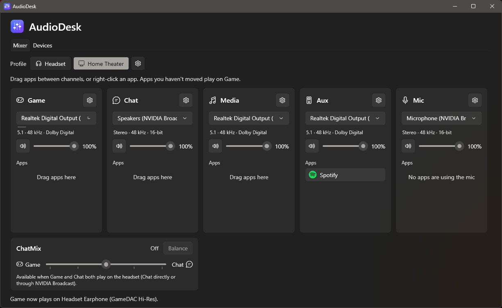
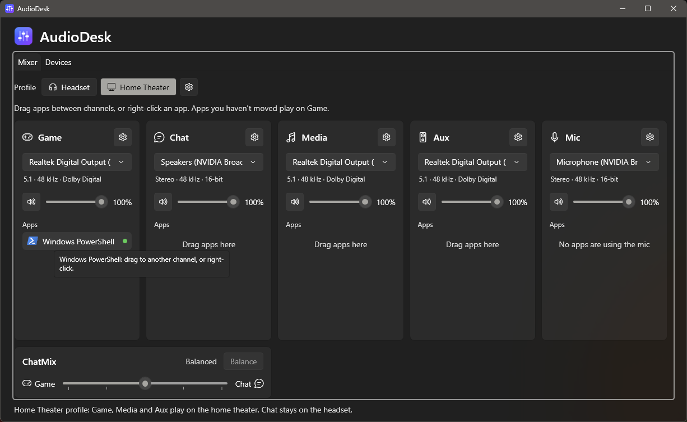
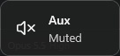

<p align="center">
  
</p>

<h1 align="center">AudioDesk</h1>

<p align="center">
  Sonar-style audio channels for Windows, without virtual audio devices.<br />
  Every app plays directly on a real device at that device's full sample rate, bit depth and channel count.
</p>

---


## Contents

- [Why AudioDesk](#why-audiodesk)
- [Features](#features)
- [Requirements](#requirements)
- [Installing and running](#installing-and-running)
- [Using AudioDesk](#using-audiodesk)
  - [Channels](#channels)
  - [Moving apps between channels](#moving-apps-between-channels)
  - [ChatMix](#chatmix)
  - [Profiles: Headset and Home Theater](#profiles-headset-and-home-theater)
  - [Channel settings](#channel-settings)
  - [Noise removal (NVIDIA Broadcast)](#noise-removal-nvidia-broadcast)
  - [Keep device awake](#keep-device-awake)
  - [Global shortcuts](#global-shortcuts)
  - [Devices tab](#devices-tab)
  - [Tray icon](#tray-icon)
- [Setting up Discord](#setting-up-discord)
- [How it works](#how-it-works)
- [Settings file](#settings-file)
- [Command-line options](#command-line-options)
- [Troubleshooting](#troubleshooting)
- [Limitations](#limitations)
- [Building from source](#building-from-source)
- [Project structure](#project-structure)

---

## Why AudioDesk

Mixers like SteelSeries Sonar give you separate Game, Chat and Media channels by installing **virtual audio
devices**. Apps play into the virtual device, the mixer processes the sound, and then copies it to your real
headset or speakers. That design has a cost:

| | Virtual-device mixers (e.g. Sonar) | AudioDesk |
|---|---|---|
| Path | App → virtual device → mixer → real device | App → real device |
| Sample rate / bit depth | Fixed by the virtual device (often 48 kHz) | Whatever the real device runs at (e.g. 96 kHz / 24-bit) |
| Surround | Usually mixed down to stereo | 5.1 / 7.1 passes straight through |
| Extra delay | Yes (copying between devices) | None |
| EQ / virtual surround | Yes | No (that needs a virtual device) |

AudioDesk does the routing with Windows' own per-app routing, the same mechanism behind
*Settings → System → Sound → Volume mixer → App output device*. It gives that mechanism a channel-based
interface, profiles, ChatMix and shortcuts.

## Features

- **Five channels:** Game, Chat, Media, Aux and Mic, each with its own device, volume and mute.
- **Drag-and-drop routing:** drag an app from one channel to another, or right-click it and choose *Move to…*.
- **Full quality:** each channel shows the real format of its device, e.g. *5.1 · 48 kHz · Dolby Digital* or
  *Stereo · 96 kHz · 24-bit*.
- **ChatMix:** one slider to balance Game against Chat, like on a gaming headset.
- **Profiles:** switch Game, Media and Aux between your **Headset** and **Home Theater** in one click.
- **Noise removal:** one switch per channel to send Chat and Mic through NVIDIA Broadcast (when it's installed).
- **Keep device awake:** plays inaudible noise to a receiver or soundbar so it never sleeps and doesn't cut off
  the start of sounds after a pause.
- **Global shortcuts:** switch device, change volume, mute, and switch profile from inside games, with an
  on-screen confirmation.
- **Tray icon:** pick devices and profiles from the tray; AudioDesk keeps working with the window closed.
- **Self-healing routing:** new apps are sorted into their channel automatically, and if anything moves an
  app (Windows, another mixer, the app itself), AudioDesk puts it back.
- **Never freezes:** device switches run in the background and show a loader.
- Windows 11 look (Fluent theme) that follows your light/dark setting.

## Requirements

- **Windows 11**, or Windows 10 version 21H2 or later (per-app routing needs 21H2+).
- **.NET 10 Desktop Runtime** (included if you have the .NET 10 SDK).
- Optional: **NVIDIA Broadcast** (RTX GPUs) for noise removal on Chat and Mic.

AudioDesk doesn't need administrator rights and doesn't install drivers.

## Installing and running

1. Build it (see [Building from source](#building-from-source)), or use an existing build.
2. Run `publish\AudioDesk.exe`.
3. To start it automatically: right-click the tray icon → **Start with Windows**. It then starts minimised to
   the tray at sign-in.

Only one copy runs at a time. Launching it again brings the existing window to the front.

**Turn SteelSeries Sonar off** (in SteelSeries GG) while you use AudioDesk. Both programs route apps, so they
undo each other's changes. AudioDesk shows a warning banner when Sonar is running.

## Using AudioDesk

### Channels


Each card is a channel:

| Channel | What it's for | Device |
|---|---|---|
| **Game** | Games, and every app you haven't moved | Your Windows **default output**. Changing it here changes the Windows default. |
| **Chat** | Discord, Teams, Zoom… | Any output. Also becomes the Windows **communications** device. |
| **Media** | Music, videos, browsers | Any output. |
| **Aux** | Anything you want to keep separate | Any output. |
| **Mic** | Your microphone | Your Windows **default recording device**. Lists the apps currently using the mic. |

In each card:

- **Device picker:** the line under it shows what the device really runs at.
- **Volume slider and mute button.** For output channels this sets each app's own volume in the Windows mixer,
  which is applied in 32-bit float inside the audio engine, so it doesn't reduce quality. For Mic it sets the
  microphone level.
- **Apps:** the apps in this channel. A green dot means the app is playing right now.

**When a device disappears** (unplugged, or NVIDIA Broadcast closed), Chat, Media and Aux keep working: the
channel temporarily uses the device it used before noise removal, otherwise your headset, otherwise Game's
device. The card says *Saved device is unavailable, using this one for now*, and the channel goes back to the
saved device by itself when it returns. The **Mic** channel's volume is re-applied whenever the microphone
changes, so a mic that comes back at 0% (as Broadcast's does after a restart) is fixed automatically.

### Moving apps between channels

Drag an app onto another channel, or right-click it:


AudioDesk remembers the choice by program name (e.g. `chrome`, `Discord`), so the app goes back to the same
channel every time it starts. Apps appear in AudioDesk once they've opened an audio stream.

If an app keeps playing on the old device after you move it, restart that app. Some games only pick their
output device at launch.

### ChatMix

The **ChatMix** card sits under the Game and Chat channels.

- **Centre (Balanced):** Game and Chat both play at their full channel volume.
- **Towards Game:** Chat gets quieter. The label shows its level, e.g. *Chat 40%*.
- **Towards Chat:** Game gets quieter, e.g. *Game 40%*.
- **Balance** button, or double-click the slider: back to the centre.

ChatMix combines with each channel's own volume slider.

ChatMix balances two things you hear on the same headset, so it's only **available when Game plays on the
headset and Chat does too**, either directly or through NVIDIA Broadcast's speakers. Otherwise (for example with
Game on the home theater) the card shows **Off**, the slider is disabled, and ChatMix has no effect; your slider
position is kept for when it's available again.

### Profiles: Headset and Home Theater

The **Profile** buttons above the channels move Game, Media and Aux together:

| Profile | Game, Media, Aux | Chat | Mic |
|---|---|---|---|
| **Headset** | → headset | not changed | not changed |
| **Home Theater** | → home theater | kept on the headset* | not changed |

\* If Chat was on the home theater, it's moved to the headset. Any other Chat device, such as NVIDIA Broadcast,
is left alone.

The active profile is highlighted. If your channels match neither profile, neither button is highlighted.

While a switch is in progress, each affected channel shows a thin loader bar right under its device picker
(here, Game switching):



Result:



The **⚙** next to the profiles chooses which device each profile uses, and holds the profile shortcuts:


If you change speakers (e.g. from an optical receiver to analogue 5.1 speakers), just pick the new device as
**Home Theater** here.

### Channel settings

Each channel has a **⚙** button that opens its settings:


- **Device:** the full device name (the drop-down cuts long names off) and its real format.
- **Noise removal:** Chat and Mic only, and only when NVIDIA Broadcast is installed. See below.
- **Shortcuts:** see [Global shortcuts](#global-shortcuts).
- **Windows sound settings:** opens the classic Sound control panel (Recording tab for Mic).

### Noise removal (NVIDIA Broadcast)

With [NVIDIA Broadcast](https://www.nvidia.com/en-us/geforce/broadcasting/broadcast-app/) installed, Chat and
Mic get a **Noise removal** option:

- **On:** the channel uses Broadcast's virtual device, *Speakers (NVIDIA Broadcast)* for Chat or
  *Microphone (NVIDIA Broadcast)* for Mic. Broadcast cleans the audio and passes it to your real device.
- **Off:** the channel goes back to the device it used before.

Only voice goes through Broadcast. Game, Media and Aux stay direct and keep full quality.

Set Broadcast up once, in the Broadcast app:

1. **Microphone** tab: source = your real microphone, *Noise Removal* on.
2. **Speakers** tab: output = your real headset, *Noise Removal* on.

When it's installed, Broadcast may make itself the Windows default device. If so, set **Game** back to your
headset in AudioDesk. If people can't hear you, check the level of *Microphone (NVIDIA Broadcast)*: set the Mic
channel volume to 100%.

### Keep device awake

Many receivers and soundbars, especially on optical (S/PDIF) or HDMI, go to sleep when the audio signal stops.
When sound starts again they need a moment to lock back on, so the first second gets cut off, e.g. after you
pause a video for a while and press play.

**Keep device awake** fixes this by playing very quiet white noise to the device, so the signal never stops.
Turn it on with the **Keep awake** checkbox on the [Devices tab](#devices-tab), and pick the level next to it.

The noise only plays while a channel (Game, Chat, Media or Aux) is using the device. With the Headset profile
active, a kept-awake home theater gets no noise; switch to Home Theater and it starts automatically. While it's
waiting, the device's card says *Keep awake is paused: no channel uses this device*.

| Level | Use |
|---|---|
| Inaudible (−80 dB) | Default; enough for most receivers |
| Very quiet (−70 dB) | If the device still falls asleep |
| Quiet (−60 dB) | Last resort |

- The setting is saved per device and starts with AudioDesk. If the device restarts (default switch, unplug,
  format change), the noise starts again automatically.
- The noise is mixed by Windows like any other sound, so it also goes through effects such as Dolby Digital Live
  encoding, which keeps the encoded stream running too.
- While the noise plays, the device is always in use: the receiver won't go to standby on its own, and players
  that need the device **exclusively** (bitstream passthrough in VLC, MPC, Kodi) can't open it. Turn it off for
  those.

### Global shortcuts

Shortcuts work everywhere, including in games.

**Per channel** (in the channel's ⚙):

| Shortcut | Does |
|---|---|
| Switch device | Moves the channel to its next device (*Switch microphone* on Mic) |
| Volume up / Volume down | ±5% per press; hold to keep changing. Also unmutes. |
| Mute / unmute | Toggles mute |

**Profiles** (in the profile ⚙):

| Shortcut | Does |
|---|---|
| Switch profile | Toggles between Headset and Home Theater |
| Headset / Home Theater | Switches to that profile |

To set a shortcut, click its box (it says *Press keys…*) and press the combination:

- Hold **Ctrl**, **Alt** or **Shift** with the key. **F-keys** can be used alone.
- **Esc** cancels, and **Backspace** or the **✕** button removes the shortcut.
- If the keys are already used by another AudioDesk shortcut, or by another program, the row shows a red message.

Each shortcut shows a short on-screen confirmation at the bottom of the screen. It never takes focus, so it
won't interrupt a game:



### Devices tab


All active playback and recording devices with their real format. **Default** marks the Windows default
device and **Calls** the communications device; **Virtual** marks virtual devices. Use **Make default** and
**Use for calls** to change them, and **Keep awake** to [keep a playback device awake](#keep-device-awake).

### Tray icon

Closing the window keeps AudioDesk running in the tray, so channels and shortcuts keep working.

- **Left-click:** open the window.
- **Right-click:**
  - **Headset / Home Theater:** switch profile (the active one is ticked).
  - **Game / Chat / Media / Aux / Mic:** pick that channel's device.
  - **Open AudioDesk**, **Start with Windows**, **Exit**.

Windows may put the icon in the hidden-icons area (**^** next to the clock). Drag it onto the taskbar to keep it
visible.

## Setting up Discord

Discord uses three devices: chat output (voices), chat input (your mic), and normal audio (videos, embeds,
sounds).

In Discord → **User Settings → Voice & Video**:

| Discord setting | Set to |
|---|---|
| Input Device | **Default** (your Mic channel) |
| Output Device | Your **Chat** device, e.g. **Speakers (NVIDIA Broadcast)** |
| Noise Suppression | **None** if you use Broadcast (running both can sound robotic) |
| Echo Cancellation | Off when using a headset |
| Attenuation | **0%** (let ChatMix handle the balance) |

Then, in AudioDesk, put **Discord** in the channel you want its normal audio in (Game or Media). Its voices
appear in the **Chat** column marked **Voice**, and follow Chat's volume and ChatMix.

Also: run `mmsys.cpl` → **Communications** tab → **Do nothing**, so Windows doesn't lower other sounds during
calls.

## How it works

- **Per-app routing:** apps are sent to their channel's device with Windows' per-app default endpoint
  (`IAudioPolicyConfigFactory`, the API behind the Volume mixer's per-app device setting). Windows remembers it
  per program. Apps in Game have no override, so they follow the Windows default.
- **Default devices:** Game and Mic *are* the Windows default playback and recording devices, set with
  `IPolicyConfig` (the same call the Sound control panel uses). Chat also sets the communications device.
- **Enforcement:** every 1.5 s AudioDesk scans audio sessions and re-applies routing where needed. This is how
  new apps get sorted, and how apps moved by something else are put back.
- **Volume:** channel volume, mute and ChatMix are applied to each app's session volume. Audio that an app sends
  directly to the Chat device (like Discord's voice) counts as Chat.
- **No freezing:** switching a default device can take a couple of seconds while the device restarts (an
  S/PDIF output with Dolby encoding also restarts its encoder). Switches, session scans and device reads run on
  worker threads. The window reads devices from a cache that refreshes when Windows reports a change.
- **Rendering:** the window uses WPF's software renderer, because GPU rendering drew a blank window on the
  development PC.

## Settings file

Settings are saved to:

```
%APPDATA%\AudioDesk\mixer.json
```

It contains the channel devices, volumes and mute states, which channel each app belongs to (by process name),
ChatMix, profile devices, all shortcuts and the kept-awake devices with their noise levels. It's plain JSON. To start over, quit AudioDesk and delete the file.

Windows also remembers per-app device choices itself. To clear those: *Settings → System → Sound → Volume
mixer → Reset*.

## Command-line options

| Option | Effect |
|---|---|
| `--minimized` | Start in the tray without opening the window (used by *Start with Windows*). |
| `--selftest [file]` | Headless check: lists devices with formats and apps with their routing, and tests per-app routing on AudioDesk's own process. Writes a report to `file` (default `%TEMP%\AudioDesk-selftest.txt`) and exits. |

## Troubleshooting

| Problem | Fix |
|---|---|
| Apps jump back to other devices | SteelSeries Sonar (or another mixer) is running. Turn it off in SteelSeries GG. |
| An app doesn't move to its channel's device | Restart the app. If the app has its own device setting, set it to **Default**: apps that pick a specific device ignore per-app routing. |
| An app isn't listed | It appears once it opens an audio stream (starts playing or joins a call). |
| Everything suddenly plays through NVIDIA Broadcast | Broadcast made itself the default device. Set **Game** back to your headset. |
| People can't hear me with noise removal on | Check the Mic channel volume (AudioDesk re-applies it when Broadcast's mic comes back at 0%). Check Broadcast's Microphone source. |
| Chat says "Saved device is unavailable" | Its device is gone (e.g. NVIDIA Broadcast was closed). Chat uses a stand-in and switches back when the device returns. |
| No sound in Chat with noise removal on | In the Broadcast app, set the Speakers output to your headset. |
| A shortcut shows "already used by another app" | Another program owns that combination. Choose a different one. |
| The start of sounds is cut off on a receiver/soundbar | Turn on [Keep device awake](#keep-device-awake) for that device. |
| A bitstream/passthrough player can't open the device | Turn off Keep device awake for that device while you use the player. |
| Tray icon missing | It's in the hidden-icons area (**^**). Drag it onto the taskbar. |

## Limitations

- **No EQ, virtual surround or effects.** Those need the audio to pass through a processor (a virtual device),
  which is exactly what AudioDesk avoids.
- **Undocumented Windows APIs.** Per-app routing and default-device switching use interfaces that Windows itself
  uses but doesn't document. They've been stable for years, but a future Windows update could change them.
- **Some apps ignore per-app routing,** namely those that choose a specific output device themselves.
- Settings key apps by process name, so two different programs with the same executable name share a channel.

## Building from source

Requires the **.NET 10 SDK** on Windows.

```powershell
cd AudioDesk
dotnet build -c Release                  # bin\Release\net10.0-windows\AudioDesk.exe
dotnet publish -c Release -o publish     # publish\AudioDesk.exe
```

Quit a running AudioDesk first (tray → Exit), because Windows locks the files of a running program.

**Icons:** `Assets\logo.svg` is the source design. To regenerate the PNGs and the multi-size `AudioDesk.ico`
(16–256 px, with a hand-tuned 16 px version), run:

```powershell
powershell -ExecutionPolicy Bypass -File Assets\make-icons.ps1
```

Dependencies: [NAudio.Wasapi](https://github.com/naudio/NAudio) 2.2.1 for Core Audio access.

## Project structure

```
AudioDesk/
├─ App.xaml(.cs)            Startup, single instance, tray, shortcuts, on-screen confirmations, --selftest
├─ MainWindow.xaml(.cs)     Mixer and Devices tabs, popups, drag-and-drop, shortcut recorder
├─ ViewModels.cs            Channel, ChatMix, profile and shortcut view models
├─ TrayIcon.cs              Tray icon and its menu; Start with Windows
├─ HotkeyService.cs         System-wide shortcuts (RegisterHotKey)
├─ OsdWindow.cs             On-screen confirmation popup
├─ IconHelper.cs            App icon and app-icon lookup
├─ Converters.cs            XAML helpers (popup placement, inverse bool)
├─ Audio/
│  ├─ AudioService.cs       Devices (cached), formats, audio sessions, session/device volume
│  ├─ KeepAwakeService.cs   Quiet noise streams that keep receivers/soundbars awake
│  └─ Interop.cs            IPolicyConfig (default devices), IAudioPolicyConfigFactory (per-app routing)
├─ Mixer/
│  ├─ ChannelManager.cs     Channels, routing enforcement, profiles, ChatMix, noise removal, settings file
│  └─ Hotkey.cs             Shortcut model and storage format
├─ Assets/                  Logo (SVG, PNG), AudioDesk.ico, make-icons.ps1
└─ docs/screenshots/        Images used in this README
```
